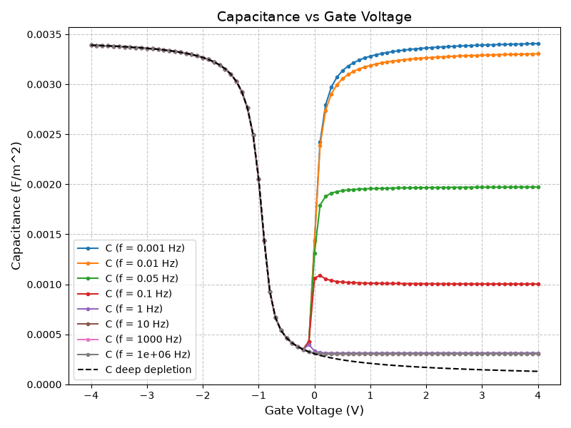

# MOS-Capacitor-Simulator

A one-dimensional simulator for a **MOS capacitor**, written in C++. It solves Poisson's equation and the drift-diffusion equations and produces C–V curves (low frequency, high frequency and deep depletion), conductance, frequency sweeps and transient responses. Python is used for plotting.



---
## Table of Contents
- [Features](#features)
- [Quick start on Ubuntu / Linux](#quick-start-on-ubuntu--linux)
- [Running on Windows](#running-on-windows)
- [What a run produces](#what-a-run-produces)
- [Changing the simulation](#changing-the-simulation)
- [Repository layout](#repository-layout)
- [Physics and numerical methods](#physics-and-numerical-methods)
- [Limitations](#limitations)

---

## Features

- p-type or n-type substrate, gate work function and fixed oxide charge.
- Non-uniform mesh: fine at the oxide–semiconductor interface, coarse in the bulk.
- Steady state at each gate voltage (Poisson + Scharfetter–Gummel drift-diffusion + Shockley–Read–Hall recombination).
- Small-signal AC analysis at any frequency, giving capacitance C and conductance G.
- Bias sweeps (C–V, G–V) and frequency sweeps (C–f, G–f).
- Deep-depletion C–V curve (the limit of a very fast gate sweep).
- Transient simulation: C–V at a chosen gate sweep rate, and C–t recovery after a gate step.

---

## Quick start on Ubuntu / Linux

1. **Install the tools** (a C++17 compiler, make, Python 3 with numpy and matplotlib):
   ```bash
   sudo apt update
   sudo apt install build-essential python3 python3-numpy python3-matplotlib
   ```
   If you prefer pip for the Python packages: `pip install -r requirements.txt`.

2. **Get the code and build it**:
   ```bash
   git clone https://github.com/FortuneDevil/MOS-Capacitor-Simulator.git
   cd MOS-Capacitor-Simulator
   make
   ```

3. **Run the simulator** (takes a few seconds, writes the data to `csv_files/`):
   ```bash
   ./moscap_sim
   ```

4. **Make the figures** (writes them to `figs/`):
   ```bash
   make plots
   ```

`make run` does steps 2 and 3 together, and `make clean` removes the build output. After the first build, plain `make` is enough for any change in a `.cpp` or `.hpp` file.

The repository also has a GitHub Actions workflow (`.github/workflows/build.yml`) that builds and runs the simulator on Ubuntu on every push.

---

## Running on Windows

Install [MSYS2](https://www.msys2.org/), open the **MSYS2 UCRT64** shell and install the tools once:

```bash
pacman -S make mingw-w64-ucrt-x86_64-gcc mingw-w64-ucrt-x86_64-python-numpy mingw-w64-ucrt-x86_64-python-matplotlib
```

Then use the makefile in the `windows` folder. It keeps all Windows build output inside that folder.

```bash
cd windows
make run     # builds windows/moscap_sim.exe and runs it from the repo root
make plots   # makes the figures
```

---

## What a run produces

The simulator writes these files to `csv_files/`, and `make plots` (or `plot/plot.sh`) turns each one into a figure in `figs/`. Every run overwrites the previous files. Capacitances are per unit area (F/m²).

| Data file | Figure | Contents |
|---|---|---|
| `eq.csv` | `eq.png` | V, n, p against depth at equilibrium (VG = 0) |
| `dc.csv` | `dc.png` | V, n, p against depth at the last gate voltage of the sweep |
| `ac.csv` | `ac.png` | Real and imaginary parts of the AC changes of V, n, p at that gate voltage, at the highest frequency, per volt of gate signal |
| `VG_C.csv` | `cv.png` | Capacitance against VG: one curve per frequency, plus the deep-depletion curve |
| `VG_G.csv` | `gv.png` | Conductance over angular frequency (G/w) against VG, one curve per frequency |
| `f_C.csv` | `cf.png` | C and G/w against frequency at a few gate voltages |
| `VG_C_sweep.csv` | `cv_sweep.png` | Capacitance against VG with the gate swept at different rates, with the equilibrium and deep-depletion curves for reference |
| `t_C.csv` | `ct.png` | Capacitance against time after the gate is stepped into inversion |

The simulator also prints the work-function difference and the flat-band voltage, a "Converged at iteration …" line for each steady-state solve, and a warning if a solve does not converge.

---

## Changing the simulation

All parameters are in **`main/settings.cpp`**, in SI units. Edit the file, then run `make` and the simulator again.

| Group | Parameters |
|---|---|
| Device | `NA`, `ND` (doping; `NA > ND` is p-type, `ND > NA` is n-type), `phi_m` (gate work function), `Q_f` (fixed oxide charge), `t_ox`, `T`, `ni`, `mu_n`, `mu_p`, `tau_n`, `tau_p` |
| Mesh | `x_points`, `start_SC`, `a_x`, `b_x` |
| Bias sweep | `VG_l`, `VG_u`, `n_VG`, `freqs` |
| Frequency sweep | `sweep_VG`, `f_min`, `f_max`, `points_per_decade` |
| Transient | `sweep_rates`, `substeps`, `step_fractions`, `t_ramp`, `t_first`, `t_last`, `growth` |

Physical constants and solver tolerances are in `main/main.hpp`.

---

## Repository layout

| Folder | Contents |
|---|---|
| `main/` | `settings.cpp` (all parameters), `main.cpp` (the sequence of simulations), `output.cpp` (CSV writers), `main.hpp` |
| `poisson/` | Newton step of Poisson's equation |
| `carrier/` | Steady-state carrier continuity equations |
| `ac/` | Small-signal AC analysis |
| `transient/` | Time-dependent solver |
| `math/` | Bernoulli function, matrix class, tridiagonal and block-tridiagonal solvers |
| `plot/` | Python plot scripts and `plot.sh`, which runs them all |
| `csv_files/`, `figs/` | Results of the last run |
| `equations/` | `equations.pdf`: the equations exactly as implemented (LaTeX source `equations.tex`); `presentation.pdf` |
| `windows/` | Makefile for Windows (MSYS2) |
| `old_files/` | Earlier versions kept for reference; not used by the simulator |

---

## Physics and numerical methods

The full derivation is in [`equations/equations.pdf`](equations/equations.pdf). In short:

- **Poisson's equation**
  ```math
  \frac{d}{dx} \left( \varepsilon \frac{dV}{dx} \right) = -q\,(N_D - N_A + p - n)
  ```
- **Carrier continuity**, with Shockley–Read–Hall recombination
  ```math
  \frac{\partial n}{\partial t} = \frac{1}{q} \frac{\partial J_n}{\partial x} - R, \qquad
  \frac{\partial p}{\partial t} = -\frac{1}{q} \frac{\partial J_p}{\partial x} - R, \qquad
  R = \frac{np - n_i^2}{\tau_p (n + n_i) + \tau_n (p + n_i)}
  ```
- **Discretisation:** finite volumes on the non-uniform mesh, Scharfetter–Gummel currents.
- **Steady state:** Poisson and the two continuity equations are solved in turn until they agree. The gate is moved in steps of at most 0.1 V.
- **Small-signal AC:** every quantity is its DC value plus a phasor. The linearised Poisson and continuity equations are solved together, once per bias and frequency. The gate charge gives $`C = \mathrm{Re}(\tilde{Q}/\tilde{v})`$ and $`G/\omega = -\mathrm{Im}(\tilde{Q}/\tilde{v})`$.
- **Deep depletion:** the minority carrier is frozen at its profile at the accumulation end of the sweep.
- **Transient:** backward Euler in time, with Poisson and both continuity equations solved together by Newton's method.
- **Linear solvers:** the carrier fluxes are up to 10¹⁷ times larger than the recombination and time terms they balance. The tridiagonal solvers are arranged so that they never subtract these fluxes from each other, which keeps the small terms accurate.

---

## Limitations

- One-dimensional, ideal device: no interface traps, no gate leakage, no quantum or poly-gate depletion effects.
- Boltzmann statistics; constant mobilities and lifetimes; uniform doping.
- The mesh is about 1.3 µm deep with the default settings. In deep depletion at large gate voltages (roughly above 10 V) the depletion region reaches the bulk contact; increase `x_points` for that.
